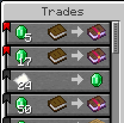
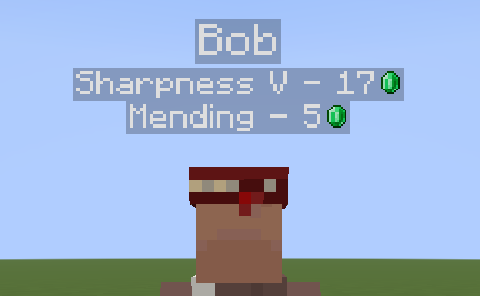
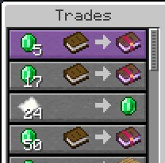
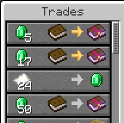
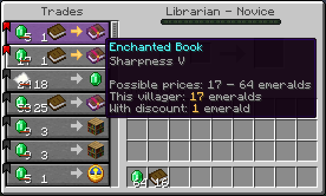
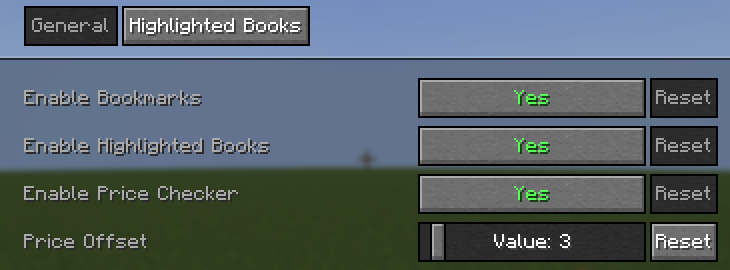
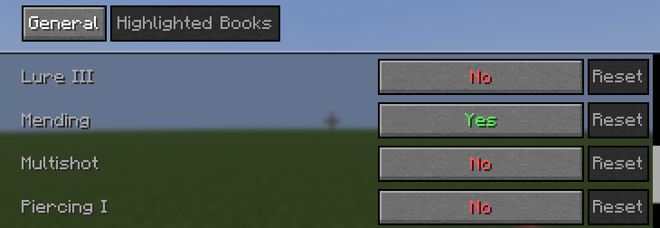

# 📜 Cherished Trades

**Cherished Trades** makes villager trading easier. Pin the trades you care about, spot the enchanted books you are hunting for, and see at a glance whether a price is a good deal.

It is a lightweight, **client-side** mod: it works in singleplayer and on any server, with nothing to install on the server.

---

## ✨ Features

### 🔖 Bookmark trades

Click the bookmark next to a trade to pin it to the top of the list. Bookmarks are remembered per villager and per world or server, so your favourite trades are always first when you come back.

### 🏷️ See bookmarks above villagers

Look at a villager and its bookmarked trades appear above its head, under its name if it has one. No more opening every villager in your trading hall to find the Mending librarian.

### 📚 Highlighted books

Choose the enchanted books you are looking for, and any trade selling one is highlighted. Great for rerolling librarians. Mending and Unbreaking III are selected by default.

### 💰 Price checker

A gold arrow marks enchanted books sold at the lowest price a villager can roll. It looks at the villager's own price, so temporary discounts such as Hero of the Village don't make a bad deal look good.

Hover over a book to see every price it can have, what this villager asks, and the lasting discount you get from curing it.

---

## ⚙️ Configuration

Open the settings from [Mod Menu](https://modrinth.com/mod/modmenu).

- **Enable Bookmarks**: show the bookmark icons, and the bookmarked trades above villagers.
- **Enable Highlighted Books**: highlight the books picked in the *Highlighted Books* tab. Turning it off keeps your choices.
- **Enable Price Checker**: show the gold arrow and the price tooltip.
- **Price Offset**: also count prices slightly above the lowest as a good deal. An offset of 2 means "lowest price + 2".

In the **Highlighted Books** tab, every enchantment villagers can sell is listed, one toggle per level.

---

## 📦 Requirements

- Minecraft **26.3**
- [Fabric Loader](https://fabricmc.net/) and [Fabric API](https://modrinth.com/mod/fabric-api)
- [Mod Menu](https://modrinth.com/mod/modmenu) *(optional, to open the settings)*

Cloth Config is already included.

---

## 📝 Notes

- Bookmarks are stored on your computer, so they work on any server and stay with you.
- Found a bug or have an idea? [Open an issue](https://github.com/rodrigograc4/Cherished-Trades/issues).
- You are free to add this mod to any modpack.
